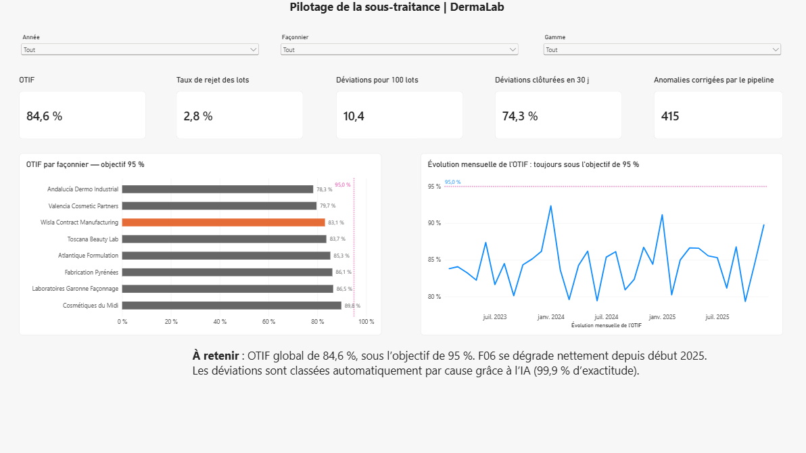
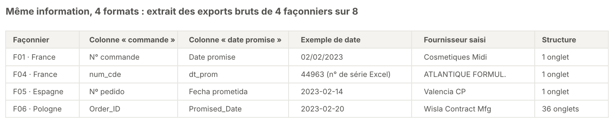
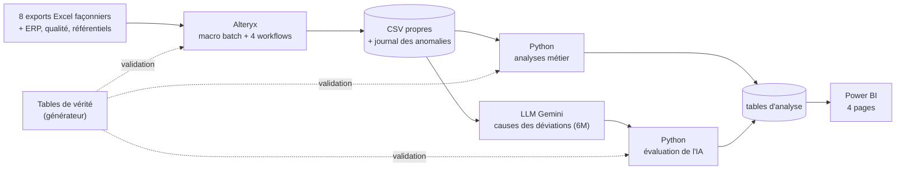
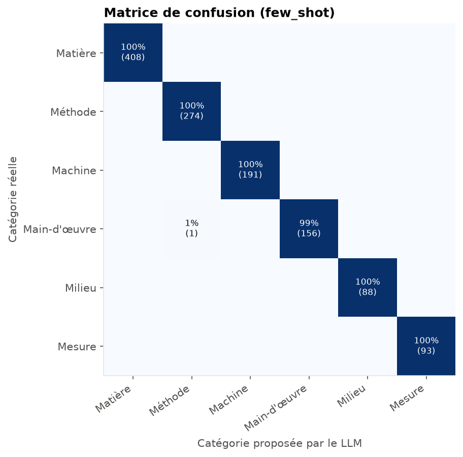
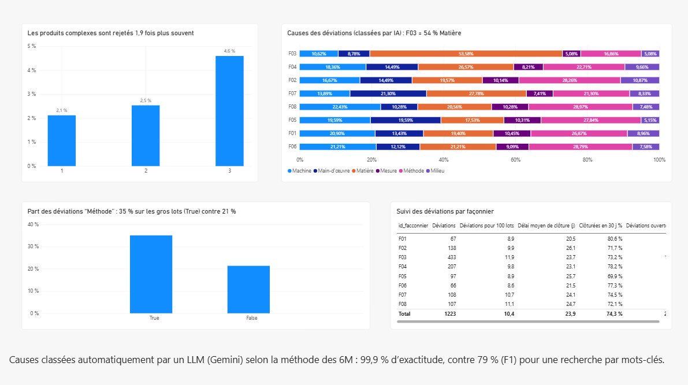

# External Manufacturing Cockpit

**Piloter la sous-traitance industrielle à partir de fichiers fournisseurs hétérogènes** : un pipeline de bout en bout (Alteryx, Python, LLM, Power BI) qui transforme les exports de 8 façonniers en indicateurs fiables et en recommandations pour les équipes achats et qualité d'un laboratoire dermo-cosmétique fictif, DermaLab.


| [**415 / 415**](docs/verification_detection.csv) | [**0**](docs/rapport_qualite_donnees.pdf) | [**32**](data/processed/correspondance_noms.csv) |
|---|---|---|
| anomalies de données détectées | fausse alerte | variantes de noms de fournisseurs unifiées |
| [**5 / 5**](notebooks/01_analyses_metier.ipynb) | [**0,5 pt**](notebooks/01_analyses_metier.ipynb) | [**99,9 %**](notebooks/02_evaluation_ia.ipynb) |
| problèmes métier retrouvés sans les connaître à l'avance | écart maximal d'OTIF avec la vérité | d'exactitude de l'IA sur les causes des déviations |



📄 Pour un lecteur non technique : [note de synthèse d'une page](docs/note_de_synthese.pdf) · 📊 [tableau de bord complet en PDF](powerbi/external_manufacturing_cockpit.pdf)

> Toutes les données sont **synthétiques**, générées par [`src/generation.py`](src/generation.py). DermaLab et ses façonniers sont fictifs.

## Le problème métier

DermaLab fait fabriquer ses produits par 8 façonniers en France, en Espagne, en Italie et en Pologne. Chacun envoie ses commandes dans **son propre format** : colonnes en français, en espagnol ou en anglais, 3 formats de date, virgule ou point décimal, un fichier découpé en 36 onglets mensuels, et des noms de fournisseurs saisis de 32 façons différentes. Sans vue consolidée, impossible de répondre à des questions simples : quel façonnier livre en retard ? Pourquoi des lots sont-ils rejetés ? D'où viennent les déviations qualité ?



## Architecture



Les tables de vérité ne servent qu'à **valider** chaque étape : les analyses sont menées sans les consulter.

## Ce que les données révèlent

| # | Constat | Chiffre clé | Recommandation |
|---|---|---|---|
| 1 | Le façonnier F06 se dégrade depuis début 2025, à cause des retards | OTIF de **88 % → 73 %** (p < 0,001) ; les autres restent à 86 % | Achats : revue de performance et plan d'action avec F06 |
| 2 | La gamme Solaire est livrée en retard au printemps, chaque année | **85 %** à l'heure en mars-mai contre **96 %** le reste de l'année | Planification : anticiper les commandes de printemps |
| 3 | Les produits complexes sont plus souvent rejetés, chez presque tous les façonniers | Rejets **× 1,9** (4,6 % contre 2,4 %), effet présent chez 7 façonniers sur 8 | Qualité : renforcer le transfert technique et les contrôles des produits complexes |
| 4 | F03 concentre les déviations liées aux matières premières | **54 %** de déviations Matière, contre 18 à 28 % ailleurs | Qualité : audit de la réception et du contrôle des matières premières chez F03 |
| 5 | Les gros lots génèrent plus d'erreurs de méthode | **35 %** de déviations Méthode au-delà de 50 000 unités, contre 21 % (p < 0,001) | Qualité : revoir les instructions de fabrication pour les grands volumes |

Constats 1 à 3 : [`notebooks/01_analyses_metier.ipynb`](notebooks/01_analyses_metier.ipynb) · constats 4 et 5 : [`notebooks/02_evaluation_ia.ipynb`](notebooks/02_evaluation_ia.ipynb).

## Démarche, phase par phase

Le détail des décisions et des problèmes rencontrés est dans le [journal de bord](docs/journal.md).

### 1. Données synthétiques réalistes (Python)
[`src/generation.py`](src/generation.py), paramétré par [`config.yaml`](config.yaml) avec une graine fixe, produit 6 000 commandes, 11 735 lots et 1 223 déviations. Il injecte volontairement **5 problèmes métier** et **415 anomalies de données** de 6 types (doublons, livraison avant commande, quantités négatives, références inconnues, dates manquantes, quantités en milliers), puis exporte chaque façonnier dans son format. Les tables de vérité permettent ensuite de vérifier que le pipeline retrouve tout. Contrôle : [`notebooks/00_controle_generation.ipynb`](notebooks/00_controle_generation.ipynb).

### 2. Ingestion et nettoyage (Alteryx)
Une **macro batch** lit tous les fichiers et tous les onglets et renomme les colonnes grâce à un fichier de paramétrage : ajouter un façonnier revient à remplir [`mapping_colonnes.xlsx`](data/reference/mapping_colonnes.xlsx), sans toucher aux workflows (testé avec un 9e façonnier allemand). Les noms de fournisseurs sont unifiés par correspondance approximative et table d'alias. **Aucune ligne n'est perdue en silence** : chaque correction ou exclusion est tracée avec sa valeur d'origine. Résultat vérifié ligne à ligne par [`src/verifier_detection.py`](src/verifier_detection.py) et résumé dans un [rapport PDF généré automatiquement](docs/rapport_qualite_donnees.pdf).


### 3. Analyses métier (Python)
OTIF (livré à l'heure **et** complet) par façonnier et dans le temps, détection automatique du mois de rupture, saisonnalité par gamme, taux de rejet par complexité. Chaque écart est testé statistiquement et les facteurs cachés sont contrôlés (l'effet complexité est vérifié à l'intérieur de chaque façonnier). À la fin seulement, les résultats sont comparés aux tables de vérité : **OTIF à 0,5 point près**.


### 4. Classification des déviations par IA (LLM)
Les déviations qualité ne sont décrites qu'en texte libre. [`src/classifier_deviations.py`](src/classifier_deviations.py) les fait classer par Google Gemini selon les **6M** (Matière, Méthode, Machine, Main-d'œuvre, Milieu, Mesure), avec une réponse JSON contrainte par un schéma, une reprise automatique en cas de quota et des résultats enregistrés pour une évaluation reproductible. Exactitude de **99,9 %** contre 33,7 % pour une réponse naïve, et F1 de 100 % contre 79 % pour un repérage par mots-clés.



### 5. Tableau de bord (Power BI)
Modèle en étoile (4 tables de faits, 3 dimensions), 17 mesures DAX et 4 pages : vue d'ensemble, livraisons, qualité, qualité des données. Chaque titre de visuel énonce la conclusion. L'OTIF affiché (84,6 %) est identique à celui calculé en Python.



## Compétences démontrées

| Compétence | Preuve dans le dépôt |
|---|---|
| ETL multi-format paramétrable | [`alteryx/macro_normalisation.yxmc`](alteryx/macro_normalisation.yxmc), [`mapping_colonnes.xlsx`](data/reference/mapping_colonnes.xlsx) |
| Qualité et traçabilité des données | [`dq_anomalies.csv`](data/processed/dq_anomalies.csv), [rapport PDF](docs/rapport_qualite_donnees.pdf), [test du 9e façonnier](docs/test_9e_facconnier/test_facconnier_non_reference.png) |
| Statistiques appliquées | test de proportions, détection de rupture, contrôle d'un facteur caché : [notebook 01](notebooks/01_analyses_metier.ipynb) |
| IA générative appliquée | prompt métier, sortie JSON structurée, zero-shot / few-shot, gestion du quota : [`classifier_deviations.py`](src/classifier_deviations.py) |
| Évaluation de modèle | exactitude, F1 macro, matrice de confusion, comparaison à une référence : [notebook 02](notebooks/02_evaluation_ia.ipynb) |
| Modélisation BI | schéma en étoile, DAX, Power Query : [`powerbi/`](powerbi/) |
| Restitution aux décideurs | titres-conclusions, [note de synthèse](docs/note_de_synthese.pdf) |
| Tests et reproductibilité | [`tests/test_sorties.py`](tests/test_sorties.py), graine fixe, clé API hors du code ([`.env.example`](.env.example)) |

## Limites et pistes

- **Données synthétiques** : les signaux sont plus nets et les données plus régulières que dans la réalité.
- **Score de l'IA optimiste** : les descriptions de déviations viennent de 48 modèles de phrases. Sur des données réelles, il faudrait annoter à la main un échantillon pour mesurer l'exactitude, et faire relire les cas incertains.
- **Chemins locaux** : le `.pbix` et les workflows Alteryx pointent vers les fichiers de mon poste (voir [Ouvrir le tableau de bord](#ouvrir-le-tableau-de-bord)).
- **Pour un cas réel** : connexion directe à l'ERP plutôt qu'à des exports Excel, exécution planifiée (Alteryx Server, Power BI Service), alertes automatiques sur l'OTIF, et un modèle d'IA hébergé ou sous contrat sans réutilisation des données (RGPD).

## Reproduire le projet

```powershell
git clone https://github.com/EyaRejeb/external-manufacturing-cockpit.git
cd external-manufacturing-cockpit
python -m venv .venv
.venv\Scripts\activate          # Windows (macOS / Linux : source .venv/bin/activate)
pip install -r requirements.txt
pytest                          # 11 tests sur les sorties, sans appel à l'API
```

Toutes les sorties sont versionnées : le dépôt se consulte sans rien relancer. Pour tout reproduire, dans l'ordre :

| Étape | Commande ou action | Produit |
|---|---|---|
| 1 | `python src/generation.py` | `data/raw/`, `data/reference/` (identiques grâce à la graine) |
| 2 | Alteryx Designer : workflows `01` → `04` du dossier `alteryx/` | `data/processed/fact_*.csv`, `dq_anomalies.csv`, rapport PDF |
| 3 | `python src/verifier_detection.py` | `docs/verification_detection.csv` |
| 4 | Notebooks `00` puis `01` | `analyse_commandes.csv`, `analyse_lots.csv`, figures |
| 5 | Copier `.env.example` en `.env` et y mettre une clé Gemini (gratuite sur Google AI Studio), puis `python src/classifier_deviations.py --mode zero-shot` et `--mode few-shot` | `deviations_classees_*.csv` |
| 6 | Notebook `02` | `analyse_deviations.csv`, figures |
| 7 | Power BI Desktop : `powerbi/external_manufacturing_cockpit.pbix` | tableau de bord |

Le fichier `.env` est ignoré par Git : la clé API n'est jamais versionnée.

### Ouvrir le tableau de bord

- **Sans Power BI** : le [PDF](powerbi/external_manufacturing_cockpit.pdf) et les [captures](powerbi/captures/) montrent les 4 pages.
- **Avec Power BI Desktop** : le fichier s'ouvre avec les données enregistrées. Pour l'actualiser sur un autre poste, les sources pointent vers des chemins locaux : **Transformer les données → Paramètres de la source de données → Changer la source**, puis indiquer pour chaque fichier le même CSV dans votre clone, et **Actualiser**.

## Structure du dépôt

```
config.yaml              paramètres du générateur (graine, volumes, signaux, anomalies)
src/                     génération, vérification, classification IA
alteryx/                 macro + workflows 01 à 04, captures
data/raw/                exports bruts des façonniers, ERP, qualité, référentiels
data/processed/          tables nettoyées (Alteryx), tables d'analyse, résultats de l'IA
data/reference/          paramétrage, anomalies injectées, tables de vérité
notebooks/               00 contrôle · 01 analyses métier · 02 évaluation de l'IA
powerbi/                 tableau de bord .pbix, export PDF, captures
docs/                    journal de bord, note de synthèse, rapport qualité, figures
tests/                   tests automatisés (pytest)
```

## Auteure

**Aya Rejeb**, élève ingénieure en dernière année, Informatique et Systèmes d'Information pour la Santé.
Projet personnel de portfolio, sous [licence MIT](LICENSE).
