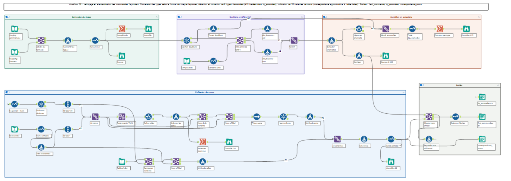
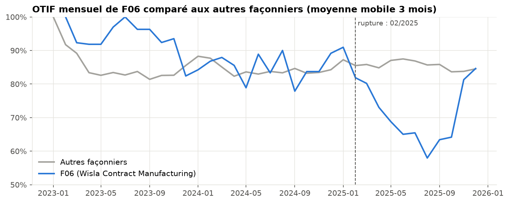

# External Manufacturing Cockpit

Pipeline de données et tableau de bord de pilotage de la **sous-traitance industrielle** (façonniers) pour un laboratoire dermo-cosmétique fictif, **DermaLab Laboratoires**.

> Toutes les données sont **synthétiques**, générées par `src/generation.py`. Aucune donnée réelle d'entreprise n'est utilisée.

## Problème métier
8 façonniers en France, Espagne, Italie et Pologne envoient chacun leurs commandes dans **leur propre format** : colonnes en français, espagnol ou anglais, 3 formats de date, virgule ou point décimal, un fichier découpé en 36 onglets mensuels, et des noms de fournisseurs saisis de 32 façons différentes. Impossible de suivre la performance (délais, quantités, qualité) sans un travail manuel lourd.

## Ce que fait le projet
| Étape | Outil | Résultat |
|---|---|---|
| 1. Génération des données | Python | 6 000 commandes, 11 735 lots, 1 223 déviations qualité, 415 anomalies injectées |
| 2. Ingestion et nettoyage | **Alteryx** (macro batch + 4 workflows) | Tables propres, **415/415 anomalies détectées**, 32 variantes de noms unifiées |
| 3. Analyses métier | Python | **5 signaux retrouvés** (dérive F06, saisonnalité Solaire, rejets ×1,9 en complexité 3…), validés à 0,5 pt près |
| 4. Classification IA des déviations | Python | *à venir* |
| 5. Tableau de bord | **Power BI** | *à venir* |

## Points forts du pipeline Alteryx
- **Paramétrage plutôt que code** : un nouveau façonnier s'ajoute en remplissant `mapping_colonnes.xlsx`, sans toucher aux workflows (testé avec un 9e façonnier allemand).
- **Aucune perte silencieuse** : chaque ligne exclue ou corrigée est tracée dans `dq_anomalies.csv` avec sa valeur d'origine et l'action appliquée.
- **Vérification ligne à ligne** de la détection contre les anomalies injectées : 0 manquée, 0 fausse alerte.
- Rapport qualité des données généré automatiquement en PDF : [`docs/rapport_qualite_donnees.pdf`](docs/rapport_qualite_donnees.pdf).





## Structure
```
config.yaml              paramètres de génération
src/                     génération des données et vérifications
alteryx/                 macro + workflows 01 à 04, captures
data/raw/                exports bruts des façonniers, ERP, qualité, référentiels
data/processed/          tables nettoyées (sorties Alteryx)
data/reference/         mapping, anomalies injectées, tables de vérité
docs/                    journal, rapport PDF, preuves de tests
notebooks/               contrôles et analyses
```

## Reproduire
```bash
python -m venv .venv
.venv\Scripts\activate          # Windows
pip install -r requirements.txt
python src/generation.py        # régénère data/raw et data/reference
```
Puis exécuter dans Alteryx Designer les workflows `01` → `04` du dossier `alteryx/`.

## Auteure
Aya Rejeb - élève ingénieure, Informatique et Systèmes d'Information pour la Santé.